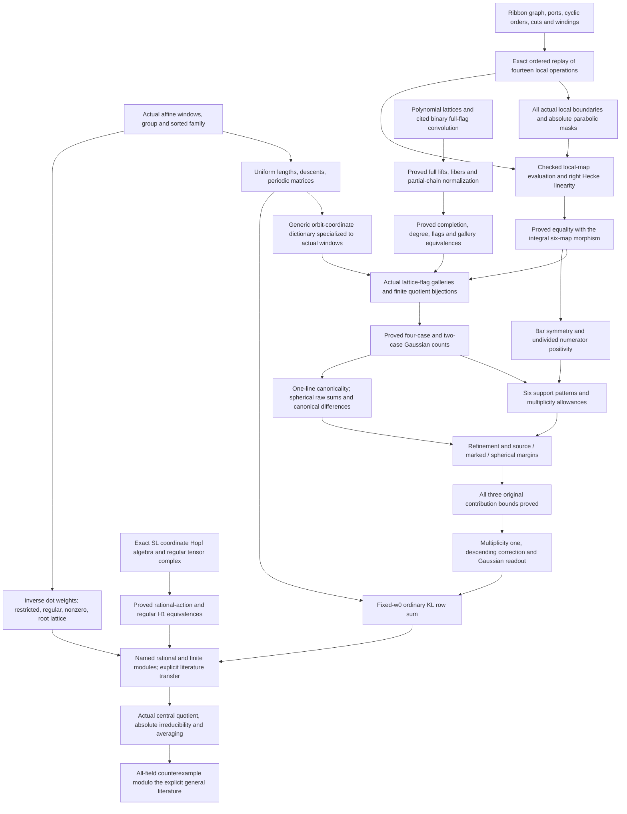

# Manuscript-to-Lean proof map

This map concerns the updated `PolishedWebProof/main.tex`, identified by its
LaTeX labels and `certificates/manuscript-review.json`. It was compared with
the manuscript on 2 November 2026; the manuscript was not edited. A theorem
proved **modulo literature** is a Lean theorem whose general mathematical
inputs are explicit arguments; those inputs are not declared Lean axioms.
The original argument is assembled in `WebProof.lean`. The final
`ModelComparisonCounterexample.lean` wrapper passes through the proved
polynomial/completed-lattice and coordinate-H1 conversions; its row theorem
and counterexample theorem have only the stated general literature inputs. The existence of those inputs has not been constructed
in Lean, so this is not an unconditional formal counterexample. See
[reports/verification.json](reports/verification.json) for the latest full
build and audit result.

## Target, quantifiers, and the fixed source

`Cohomology.AbsoluteBoundedness` states that one natural-number bound works
for every field, every finite group, and every faithful finite-dimensional
absolutely irreducible representation. `AbsolutelyIrreducible` is defined
using the actual tensor-product representation over the algebraic closure.
The implication from irreducibility over an algebraically closed field is
proved in `AbsoluteIrreducibility.lean`; this bridge is no longer missing.

The proposed witnesses are the named highest-weight modules over
`PrimeClosure p = AlgebraicClosure (ZMod p)`, descended to
`PSL_(2m+1)(F_p)`. For every `m≥2`, the desired assertion holds at every prime
above a rank-dependent threshold: the threshold must satisfy the
Andersen–AJS condition, `2m+1<p`, and `5(2m)≤p`. The numerical BNP bound alone
does not assert Lusztig's character formula. The claimed row sum is
`sum_j dim H¹(PSL_(2m+1)(F_p), M_(j;m)) = choose(m+1,2)`, giving a member
with dimension at least `m/2+1 = ceil((m+1)/2)`. No fixed-characteristic
unboundedness is asserted.

The source is fixed throughout:

```
spherical identity → ordinary C_w0 → rational H¹(SL_N,L(weight))
                   → finite H¹(SL_N(F_p),restriction)
                   → finite H¹(PSL_N(F_p),descended module).
```

An arbitrary ordinary KL coefficient, an antispherical coefficient, or
`Ext¹(L₁,L₂)` with an arbitrary first argument is not substituted for this
chain. `Cohomology.h1IsoExtFromTrivial` uses mathlib's actual `H¹`/Ext
comparison with the trivial source.

## Definitions and conventions

Set `N=2m+1`. The shifts `familyShift` have value −1 on
`{1,…,j−1,m+2}`, +1 on `{m,N−j+2,…,N}`, and zero elsewhere. Sorting
`i+N*delta_i` gives `u_(j;m)`; the actual upper endpoint is
`C_(j;m)=u_(j;m)*w0`. `Family.affine` and `Family.upper` are actual balanced
periodic permutations, not abstract labels. The gap is
`D=2j(N−j)−2(m−j)−3`.

| Object | Formal convention |
|---|---|
| Hecke algebra | `Hecke.Algebra N`, a `RingQuot` of a free Laurent-polynomial algebra by `(H_s−v⁻¹)(H_s+v)=0` and the cyclic braid relations |
| Bases | `KLRealization.standard` and `.canonical` are actual `Basis` objects in that algebra; `C_s=H_s+v` |
| Ordinary KL parameter | `Q=v⁻²`; `H_s=v*T_s`; lower canonical-to-standard coordinates are in `v Z[v]` |
| Fixed ordinary coefficient | `v^D P_(w0,C)(v⁻²)`; `familyMu` is its coefficient of `v` |
| Spherical convention | Trivial-induced right ideal generated by the finite canonical symmetrizer; finite `H_s` eigenvalue `v⁻¹` |
| Spherical indexing | `b=u⁻¹`, minimal for left finite cosets; `w0*b=C⁻¹`, with simultaneous-inversion invariance proved from `Hecke.Theory` |
| Schur convention | Source `(N,0,0)`, output `(m,1,m)`; double-coset indices are maximal representatives; standard refinements use actual normalized finite coset sums |
| Other parameters | SSW's `q=v`; the Cui/Du–Fu parameter is `v⁻¹` in this convention; dot/winding degree is separate from `v` |
| Antispherical module | Sign-induced (`H_s=−v`); not used for the transfer |
| Sizes | Three Schur rows, total thin degree `N`, the number of thick packets, and a web colour rank are distinct parameters |

The period-three family matrix, in columns `−2,1,4`, is
`[[1,m−j,j−1],[0,1,0],[j−1,m−j,1]]`; the lower matrix is
`[[0,m,0],[0,1,0],[0,m,0]]`. The entries count images of actual translated
source blocks. `FamilyUpperMatrix.lean` also checks all columns outside these
three, rather than comparing only nine selected numbers.

## Dependency graph

The main-result stages below are implemented. The separately proved seed
KL identification and the unformalized global annular category are outside this graph;
see [the current comparison](audit-updated-manuscript.md). The general framework and
representation-theoretic literature inputs remain explicit assumptions
throughout the final theorem.



## Manuscript statements and declarations

All declaration names below are relative to `Guralnick`. Within each
semicolon-separated group, an unqualified name shares the preceding
qualified name's namespace. File names are written with the `.lean` suffix.

| Manuscript location | Principal Lean declarations | What is proved |
|---|---|---|
| Family and `eq:family-coefficient` | `Family.affine`, `window_eq_familyWindow`, `entry_strictMono`; `Family.upper_inversion_gap`; `Hecke.family_length_gap` | Actual sorted affine family; uniform inversion and Coxeter length gap, using the general affine Coxeter model |
| `lem:dictionary-endpoints` | `Family.upper_finite_left_descent`, `upper_doubleMaximal`, `upper_supported`; `upper_matrixEntry_eq_prescribedArray`, `upper_matrixEntry_outside` | Actual descents, maximality and all periodic matrix entries |
| `lem:affine-schur-dictionary`, `cor:dictionary-readout` | `Hecke.KLRealization`, `CanonicalRefinement.StandardCompatibility`; `CanonicalSchurFromRefinement.toCompatibility`; `Hecke.familyMu_canonical`, `familyMu_inverse_canonical` | Precise ordinary coefficient, spherical source and inversion dictionary; canonical corner support is derived from the retained standard-span input |
| Web figures, `fig:continuous-m2` | `Web.family`, `family_wellFormed`, `family_boundaries`, `family_incident_conservation`, `family_seam_degree`; `WebMasks.stage_boundaries`, `stage_parabolics`, `stage_masks` | Explicit combinatorial ribbon graph and its exact parabolic/flag masks |
| `lem:main-symmetrizer`, `eq:marked-symmetrizer` | `SphericalMaps.spherical`, `Merge`, `SixMaps.cleared_identity`; `ParabolicWeb.Family.raw`, `raw_cleared`; `CanonicalChains.Chain.raw`, `cleared`; `CanonicalChains.main_raw_eq_chain` | Actual integral maps on cyclic right ideals and the undivided product identity |
| `lem:finite-flag-count`, `prop:gallery-standard` | `FlagConvolution.mainGalleryEquiv`; `LatticeFlags.Family.sixFiniteGalleryEquiv`; `GalleryCounting.four_case_count`; `MainGalleryCount.main_gallery_count` | Actual flag-word/quotient-configuration bijections and original finite counting decomposition |
| General specialization | `FlagConvolution.coordinate_of_uniform_count`, `nonempty_gallery_of_nonzero`; `PolynomialsFromCounts.normalized_of_count_specializations` | Exact Laurent identity and genuine nonempty support inferred from all prime-square specializations |
| `eq:gallery-source`, named endpoints | `MainSourceCoordinate.raw_source_coordinate`; `MainFamilyCoordinate.marked_raw_coordinate`, `spherical_raw_coordinate` | Actual six-map standard coefficients, not prescribed coefficient definitions |
| `lem:undivided-positivity-degree` | `Positivity.cleared_lowerBound`, `cleared_eq_zero_of_positive_bound`, `cleared_zero_or_one`; `Hecke.canonical_coordinate_barSymmetric`, `canonical_product_four_nonnegative` | Bar and degree control without claiming positivity after division |
| `prop:algebraic-six` | `CanonicalGallery.count_bound01`, `count_bound00`, `count_bound11`, boundary exclusions; `MainCanonicalSupport.raw_six_position_support`, `raw_boundary_support`; `CanonicalMultiplicityBounds.pattern_multiplicity_bounds` | Uniform support and concrete multiplicity allowances for actual canonical coefficients |
| Actual packet parameters | `WindowPacketMatrix.packetMatrix`, `WindowPacketMatrix.cumulative_rank`, `CanonicalMatrix.PacketMatrix.reconstruct`, `dimension`, `raw_gap`; `PacketIndexClassification.typeF_index`, `spherical_index` | Matrix margins and feasibility come from finite counts of actual inverse windows; named index classification is derived using generic maximal-orbit injectivity |
| `prop:one-mark-canonical` | `CanonicalOneLineFlags.oneLineGalleryEquiv`, `oneLineFiniteGalleryEquiv`, `one_line_gallery_count`; `OneLineCoordinate.maximal_coordinate`, `support_and_rank`; `CanonicalOneLineEvaluation.canonical_of_leading` | The actual retained-line word is canonical from its count, computed exponent, strict proper degrees, bar and positivity |
| Auxiliary indices | `CanonicalOneLineLeading.strong_leading`, `weak_leading`, reflected variants; `PacketCoarsening.strong_doubleMaximal`, `weak_doubleMaximal`; `CanonicalOneLinePatterns.strong_canonical`, `weak_canonical`, dual variants | The concrete supported auxiliary indices satisfy the one-line theorem's leading-matrix and coarse-maximality conditions |
| One-line source, `prop:one-mark-canonical` | `CanonicalAuxiliarySource.one_line_source_coordinate`; `CanonicalAuxiliaryMargins.source_lowerBound`, `strong_source_product`, `weak_source_product` | Exact actual source polynomial `[f] G(N−1,j−1)` with its computed normalization, and source contribution bounds |
| `lem:output-refinement`, `cor:one-mark-margin`, refined marked coefficients | `HeckeRefinement.doubleCoset_refinement`, `CanonicalRefinement.canonical_coordinate_ratio`; `RefinementWindows.spherical_length_shift`; `OneLineSpecialization.at_marked`, `at_spherical` | Actual finite-coset refinement and standard coordinates at the marked and unmarked endpoints; not a declaration that elementary diagrams are canonical |
| `prop:full-Gaussian-algebraic` | `CanonicalFlagAuxiliary.sphericalFiniteGalleryEquiv`, `spherical_gallery_count`; `CanonicalSphericalEvaluation.standard_support`, `standard_coordinate`, `raw_canonical_sum`; `CanonicalSphericalTransition.transition_matrix` | Full spherical raw word equals `sum_(r≤s) C_Zr`; consecutive subtraction gives the exact canonical Gaussian difference, including rank zero and triangular vanishing |
| `lem:all-two-mark-multiplicities` | `CanonicalRowSum.raw_family_multiplicity_one`; `WebLiterature.auxiliary_family_bound` | Actual multiplicity-one argument with the original auxiliary contribution bound discharged |
| `lem:Gaussian-cancellation` | `Gaussian.gaussian_cancellation`, `normalized_Q_lowerBound`, `normalized_Q_critical` | Uniform cancellation and coefficient `choose(m+1,2)` proved from q-Pascal recursion, including proved reciprocity and finite-series identities |
| `prop:full-correction` | `CanonicalCorrection.correction`, `correction_bar`; `CanonicalFullCorrection.proposed_residual`, `correction_unique_up_to`; `CanonicalRowSum.full_residual_positive_of_coordinates` | Explicit bar-symmetric correction and uniform descending uniqueness; residual identity is proved, not a premise |
| `thm:aggregate-web` | `WebLiterature.auxiliary_family_bound`, `nonspherical_bound`, `auxiliary_source_bound`; `WebProof.row_sum`, `row_two`, `row_three` | Complete fixed-source ordinary KL row sum, with all original contribution premises discharged; small-rank row sums are three and six |
| §7 coefficient table and corrected aggregate | `SeedWebCoordinates.raw_source`, `one_line_source`, `reflected_one_line_source`, `corrected_graph_source`; `SeedRankOne.raw_source` | All four actual web evaluations and the distinct corrected aggregate |
| §7 rank-one correction | `SeedRankOne.canonical_identity`, `SeedRankOneConvention.canonical_inverse_identity` | Full standard expansion, bar invariance, positive proper degrees and the paper's inverse-module convention |
| `lem:seed-expansion` | `SeedDecomposition.strong_multiplicity`, `reflected_strong_multiplicity`, `web_expansion` | Both retained-line multiplicities and exact five-term canonical vector identity |
| §7 four-web subtraction and `eq:calibration-full-seed` | `SeedPolynomials.four_web_identity`, `diagonal_source`, `diagonal_polynomial`, `rank_one_polynomial` | Actual vector subtraction and both ordinary fixed-source KL polynomials; no seed premise |
| `lem:application-weight` | `Family.inverse_dotZero_eq_coordinate`; `Weights.sum_coordinates`, `dynkin_bounds`, `familyWeight_nonzero`, `familyWeight_pRegular`; `LiteratureTransfer.family_dot_label` | Actual inverse dot-action, root lattice and required restricted/regular/nonzero conditions |
| Rational `H¹` | `HighestWeight.HasHighestWeight`, `SimpleHighestWeight`; `RationalCohomology.IsPolynomialRepresentation`, `RationalH1`, `toAbstractH1_injective`, `restrictionH1` | Actual matrix torus/unipotent action, regular cocycles and coboundary quotient; rational cohomology is not confused with unrestricted abstract-group cohomology |
| `prop:application-transfer` (eventual-prime version; see `audit-updated-transfer.md`) | `LiteratureTransfer.familyModule`, `familyModule_h1_dimension`, `primeFieldTransfer` | Named module and exact fixed-source KL-to-`H¹` identification, conditional only on the explicit general representation-theoretic literature inputs |
| `lem:simple-quotient` | `HighestWeight.family_restrictPrime_nontrivial`, `root_lattice_center_trivial`; `SLQuotient.center_order_invertible`, `descended_h1_dimension`, `descended_admissible`; `CentralQuotient.finiteKernelInflationLinearEquiv`, `representation_faithful_of_simple` | Explicit family nontriviality, root-lattice central action, actual inflation isomorphism, descent to PSL and faithfulness |
| `cor:guralnick` | `Counterexample.doubledRowSum_of_kl_rows`; `WebProof.doubled_row_sum`, `named_row_and_lower_bound`, `not_absoluteBoundedness` | Natural-valued actual KL coefficients, named absolutely irreducible modules and unbounded first cohomology; hypotheses are only the stated general literature inputs |

## What is input, and what is derived

The final route takes `Hecke.Theory`, `PolynomialWebLiterature`, and
`CoordinateLiteratureTransfer.Inputs`. The broader legacy `WebLiterature`
interface is constructed from them; its old field names do not identify
additional assumptions. `PolynomialWebLiterature` has exactly two fields,
`refinement` and `full_flag`; there is no separate `schur_product` premise.

| Actual final input | Mathematical content |
|---|---|
| `Hecke.Theory` | Actual affine Coxeter model, ordinary KL basis and general KL positivity; bar involutivity, inversion and diagram invariance are derived |
| `refinement` | Canonical elements lie in the appropriate normalized standard double-coset span; canonical corner support and coordinate ratios are derived |
| `full_flag` | Actual full-flag orbit classification and binary affine Hecke convolution; all partial-chain and normalization formulas are derived |

The parabolic laws, longest elements, cyclic block lengths, finite source,
flag counts, coordinate formulas, entire matrix-length dictionary and
invariance statements are proved constructions. None of the remaining
fields is a family coefficient, six-pattern list, one-line canonicality
statement, spherical transition, correction polynomial or row sum. The
precise hypotheses and sources are in [literature-inputs.md](literature-inputs.md).

`LiteratureTransfer.Inputs` separately packages highest-weight existence,
Andersen–AJS for every permitted principal-block label, BNP comparison,
Steinberg restricted irreducibility, and PSL simplicity. Nontriviality of
the actual family restriction is proved directly from its highest-weight
vector. Andersen–AJS supplies the dimension equality; its former separate
H¹ finiteness conjunct was unused and has been removed. Finite-group H¹
finiteness is proved independently. The fixed trivial source,
actual dot label and characteristic requirements are part of those
interfaces. The original family satisfies those requirements by proved
lemmas. Highest-weight existence and the comparison theorems themselves
are not represented as newly declared axioms. The dependency and necessity
checks are recorded in [audit-input-necessity.md](audit-input-necessity.md).

Mathlib supplies the underlying Coxeter-system, representation, cohomology,
linear-algebra, finite-field and tensor-product infrastructure. The remaining
major Hecke, canonical Schur and full-flag realization theorems are explicit
source-level assumptions. The elementary reductions listed above and below
are checked internally.

## Multiplicity and contribution margins

Let `r` be an actual packet rank and `l=m−r`. For `l≥1`, the six-pattern
allowance table is proved in `CanonicalMultiplicityBounds.lean`. An allowance
`E` means the actual multiplicity has Laurent support in `[−E,E]`; a
negative allowance forces vanishing. At `l=0`, the boundary argument
leaves only the desired two-marked family.

| Pattern | `(a,s,beta,delta)` | Allowance `E` |
|---|---|---|
| Full spherical | `(0,0,0,1)` | `2l−3` |
| Weak dual | `(0,1,0,0)` | `l−2` |
| Strong dual | `(0,1,0,1)` | `l−1` |
| Weak | `(0,0,1,1)` | `l−2` |
| Strong | `(1,0,0,1)` | `l−1` |
| Desired two-marked | `(1,1,0,1)` | `0` |

For an auxiliary one-line word of rank `s`, write `l=m−s`. Its source
coordinate has minimum degree `N−f−s+1`. Thus strong `f=m` gives `l+2`,
weak `f=m+1` gives `l+1`. Subtracting the corresponding allowance gives
`(l+2)−(l−1)=3` and `(l+1)−(l−2)=3`. These are actual Laurent-product
bounds, proved in `CanonicalAuxiliaryMargins.lean`; they exclude the entire
auxiliary contribution from the critical coefficient `[v]`.

At a marked endpoint of rank `r≤s`, the strong raw lower bound is
`m+s−2r+1`, and the weak bound is `m+s−2r+2`. After multiplicity allowances
the bounds are respectively `2(s−r)+2` and `2(s−r)+4`, both strictly
positive. If `s<r`, the signed Gaussian count is exactly zero. These bounds
suffice for the constant-term multiplicity-one argument. At unmarked
`Z_r`, the corresponding strong/weak products have lower bound three.
`OneLineMargins.lean` assembles these from the exact coordinates; the final
assembly uses reflection to cover the dual patterns. For full spherical
terms at marked endpoints, `CanonicalRefinement.spherical_refined_lowerBound`
provides the actual refinement shift, and `MainContributionSupport.lean`
combines it with the full allowance. These margins are checked separately
from the correction's exact source coefficient.

## Diagrams, certificates, and the precise boundary of the result

The web is not just a picture: `Web.Graph` carries vertices, ordered ports,
edge incidences, boundary order, cyclic/ribbon orders, cuts and integer
windings. Conservation, well-formedness and the seam are proved.
`WebMasks` matches all seven stage boundaries to the parabolic masks used
by the actual six maps. The algebraic evaluation is now derived from an actual checked ordered
trace of this graph. `WebTrace.family_graph` proves full replay equality;
`WebTraceEvaluation.family_graph_evaluation_eq_raw` identifies its evaluated
raw element, and `WebProof.graph_morphism_eq_sixMaps` identifies the complete
right Hecke-module map. The final `WebProof` import closure includes these
modules. Every raw standard and canonical coefficient therefore applies to
the graph, with the same correction and critical readout.

The evaluation is attached to the paper's fixed checked presentation. It
does not construct the entire SSW category, prove independence under
arbitrary presentations or annular isotopy, or verify every braid/dot
relation. Those broader results must not be inferred from the fixed-word
bridge. See `graph-evaluation.md`.

Kernel-checked finite certificates construct actual affine permutations
and verify sample windows, matrices, inversion counts and dot weights;
invalid boundary cases are rejected. The generation script is not trusted
by these proofs. Uniform family, matrix and degree theorems now go beyond
those samples. The supplied KL JSON and Python KL program are comparison
data, not a verified KL-recursion checker.

`Gaussian.normalized_Q_two` proves the **aggregate corrected** expression
`3v+7v³+7v⁵+4v⁷+v⁹`, and `Q_three_critical` proves its next critical value
six. These aggregate coordinates remain distinct from the individual
seed coefficient. `SeedPolynomials.diagonal_polynomial` now proves
`P_(w0,C_(2;2))=1+4Q+5Q²+4Q³+2Q⁴` through the actual canonical vector
identities and normalized source coordinate. It does not infer the KL
identity merely from the supplied coefficients. The conjectural individual rule `mu_(j;m)=j` is not
assumed or encoded into a definition; the proof target is the row sum.

Principal canonicality/transition/source-margin theorems have been checked
with `#print axioms`; the audited outputs use only Lean's standard
`propext`, `Classical.choice`, and `Quot.sound`. General mathematical inputs
remain visible theorem arguments. See [status.md](status.md) for the latest
build status and [gaps.md](gaps.md) for the distinction between an actual
mathematical gap and an unformalized external theorem. The original
contribution-bound assembly is complete; its former assumptions are proved
in `MainContributionBounds.lean`.


## Independent fidelity lemmas added during review

| Manuscript/interface point | Declaration | Scope |
|---|---|---|
| KL normalization and uniquely determined bases | `FidelityKL.normalize_injective`, `standard_eq`, `bar_eq`, `canonical_eq`, `polynomial_eq`, `familyMu_eq` | Any two realizations on the same actual Coxeter model agree; does not prove existence of all literature inputs |
| Primary highest-weight formula | `FidelityWeights.coordinate_eq_manuscript`, `dynkin_eq_manuscript` | Full integral coordinates and Dynkin labels, uniformly including endpoints |
| `eta_r=omega_r+omega_(N-r)` | `FidelityWeights.etaCoordinate_eq_fundamental`, `etaCoordinate_sum` | Explicit rational fundamental-weight coordinates and integral zero-sum vector |
| Displayed `m=2` module examples | `FidelityWeights.m2_j1_labels`, `m2_j2_labels` | The actual module-label vectors for arbitrary `p` |
| Seven graph stage cuts | `FidelityWeb.family_frontiers` | Actual graph-edge incidence and thickness match recorded frontiers as multisets; not an evaluation or ordered/winding equality |

None of these fidelity lemmas is used as a replacement for an original
coefficient argument. They check interpretations independently. The
consolidated audit, precise coverage gap and reproducible experiments are
in [audit-fidelity.md](audit-fidelity.md).


## The proved graph-evaluation bridge

| Step in the paper | Lean declaration | Content |
|---|---|---|
| Trivalent resolution with two seam moves | `WebTrace.family_step`, `family_graph`, `family_frontier` | Actual ordered replay, full graph equality, exact winding-sensitive frontiers |
| Absolute thin-position chart | `WebBoundary.Family.mem_index_iff`, `local_relations`; `WebTrace.familyState_boundary` | All fifteen local boundaries and their actual affine parabolics |
| Canonical changes of cut | `WebRecutPositions.step_right_positions`, `step_left_positions`; `WebTraceWinding.run_charge` | Named occupied residues preserved; individual winding conserved with cut potential |
| Excluding erased full turns | `WebPresentedWinding.seamDegree_zero`, `not_presentable_of_nonzero_seam` | Admitted ordinary-endpoint presentations have actual degree zero |
| Integral vertex resolution | `WebEvaluation.merge_linear_unique`; `WebEvaluationCompression.Resolution.fine_linear_eq_coarse` | Binary splits/merges equal the direct maps, without division |
| Actual graph interpretation | `WebTraceEvaluation.family_graph_evaluation_eq_raw` | Evaluation of the checked presentation equals the six-map raw element |
| Whole Hecke-module morphism | `WebRightLinearity.program_rightLinear`, `ext_generator`; `WebProof.graph_morphism_eq_sixMaps` | Full right-linear map equality, not just a numerical coefficient |
| Graph correction and readout | `WebProof.graph_corrected_source`, `graph_corrected_critical`, `graph_critical_eq_row_sum` | Original correction applied to actual graph; fixed-source critical value equals the actual KL row |

The earlier `FidelityWeb.family_frontiers` multiset theorem is retained,
but the new exact ordered replay is the stronger graph identification now
used. No original graph-evaluation identity was inserted into the literature
bundle. Its proof uses the same general local-map laws as the algebraic proof.


## General assumptions replaced with proofs

| Manuscript step | Lean declaration | What is now proved |
|---|---|---|
| Nonzero shared-parabolic denominator in `eq:marked-symmetrizer` | `ParabolicWeb.scalar_ne_zero` | The actual finite Laurent sum evaluates to the positive subgroup cardinality at `v=1` |
| Bar invariance of the same denominator | `ParabolicWeb.Laws.scalar_bar` | Follows from existing absorption and canonical bar invariance by a basis-coordinate calculation |
| Lifting quotient flags back to actual lattices | `LaurentLattice.interval_lift` | Every subspace between Λ and t⁻¹Λ is a finitely generated full k[[t]] lattice |
| Boundary cases for the lift | `intervalLattice_source_eq`, `intervalLattice_upper_module` | Recovers Λ at the lower endpoint and the actual shifted module at the upper endpoint |

The corresponding three fields were removed from the literature structures.
The retained method names preserve downstream statements; the replacement
proofs introduce no additional mathematical assumptions. Details and
remaining source comparisons are in `audit-assumption-reduction.md`.


## The proved lattice framework and finite completion comparison

| Role in the manuscript/framework | Lean declaration | Scope |
|---|---|---|
| Actual lattice rank and one period | `latticeBasis_card`, `periodEquiv`, `period_finite`, `period_dimension` | Exact residue-coordinate map on t⁻¹Λ/Λ; no lattice input |
| Finiteness of actual relative quotients | `exists_X_pow_smul_le`, `periodTower`, `finite_quotient` | Uniform denominator clearing and actual successive lattice periods |
| Reference and common lattices | `standardLattice`, `interLattice` | Finite generation and full Laurent span proved |
| Signed degree convention | `LatticeGallery.relative_degree_difference`, `LaurentLattice.dimension_degree` | Three actual quotient chains; exact `degree(M)-degree(Λ)` sign |
| Supply former lattice input | `LaurentLattice.provedTheory`; `GeneralLatticeFlagInput.lattice_theory` | Constructed bundle replaces the field in the external input |
| Finite polynomial/completed comparison | `PowerSeriesCompletion.completionEquiv`, `completion_parameter_mul` | Natural inclusion on actual ideal quotients, all d including zero |
| Finite incidence and dimensions | `stableSubspaceEquiv`, `subspace_inf`, `subspace_sup`, `quotient_finrank` | Parameter-stable subspaces and ambient quotient spaces |
| Bounded actual lattice correspondence | `LaurentLattice.truncatedIntervalIso`, `XStable_iff_lattice` | Actual ambient subspaces between Λ and t⁻ᵈΛ; d=0 and d=1 checked |

The subsequent global comparison is proved in `LatticeApproximation`,
`LatticeCompletionDimensions`, `LatticeCompletionShift`, `PolynomialFlags`,
`LatticeEquivariance`, and the polynomial orbit/convolution transfer modules.
See `audit-model-comparisons.md`. The original six-map element, correction,
fixed-source row theorem and named module application are unchanged.

## The proved rational coordinate comparison

| Object or bridge | Lean declarations | What is checked |
|---|---|---|
| Actual coordinate ring of SL | `SLCoordinate.evaluation_ker_eq_determinantIdeal`, `quotientDeterminantEquiv` | Over an algebraically closed field the polynomial evaluation kernel is exactly `(det−1)`, not an assumed radical replacement |
| Coordinate multiplication and inverse | `SLCoordinate.comultiplication`, `comultiplication_eval`, `antipode`, `antipode_apply` | Ordinary matrix multiplication and adjugate inverse |
| Vector-valued regular maps | `CoordinateTensor.regularEquiv`, `RationalCoordinate.cochainEquiv` | Actual tensor evaluation and inverse reconstruction |
| Representations and comodules | `toCoordinateRepresentation_pointRep`, `coordinateRepresentation_roundtrip_full`, `intertwiner_iff` | Same actual action and the tensor coaction laws; both object round trips and linear intertwiners |
| Irreducibility comparison | `RationalCoordinate.invariant_subspace_iff` | Invariant subspaces equal the tensor-image subcomodules, using right exactness |
| Tensor cochains | `RationalCoordinate.dOne_eval`, `dOne_dZero` | `d⁰(a)=ga−a`, `d¹(f)(g,h)=gf(h)−f(gh)+f(g)` and zero composition |
| Actual H¹ quotient | `RationalCoordinate.cocycleEquiv_boundaries`, `h1Equiv` | Kernel and boundary image correspond; induced quotient equivalence |
| Literature-interface fidelity | `CoordinateLiteratureTransfer.andersen_iff_function`, `bnp_iff_function` | Same weights, characteristic bounds, finite group, and fixed ordinary KL source |
| Final coordinate-model endpoint | `CoordinateLiteratureTransfer.not_absoluteBoundedness` | Counterexample through the proved comparison, conditional on the same cited general results |

The remaining interpretation of this regular complex as derived rational
cohomology is precisely Jantzen I.4.16, already listed in the literature
ledger. It is not inferred from matching numerical dimensions.

## Final route through the source models

`PolynomialWebLiterature.toWebLiterature` supplies the existing web argument
from the cited polynomial-model inputs. `CoordinateLiteratureTransfer.Inputs.toFunctionInputs`
supplies the existing family transfer from coordinate-cohomology inputs.
`ModelComparisonCounterexample.row_sum`, `named_row_and_lower_bound`, and
`not_absoluteBoundedness` compose both conversions. The named result keeps
the same highest-weight family, the same finite PSL groups, the rank-dependent
character threshold, and the separate BNP inequality `p≥5(2m)`.

The canonical polynomial endpoint flags are constructed in
`PolynomialCoordinateFlags`: their node modules are proved to be exactly
the coordinate modules and their literal affine-window translates.
`AffineLatticePosition.coordinateQuotientEquiv` supplies an actual basis
for the degree calculation, and `window_degree` proves preservation under
the balanced affine action. Endpoint realization is no longer an input.

## Elementary assumption reductions (30 October 2026)

The final `PolynomialWebLiterature` fields have been reduced; the old APIs
are supplied by proved methods. See `audit-elementary-inputs.md` for what
remains unresolved under the stricter major-theorems-only boundary.

| Mathematical step | Lean declaration |
|---|---|
| Ordinary polynomial inversion | `HeckeInversion.polynomial_inversion`, `Hecke.Theory.inversion` |
| Diagram invariance | `ElementaryCoxeterDiagram.diagramInvariance` |
| Proper cyclic parabolic finiteness/longest | `ElementaryCoxeterParabolic.subgroup_finite`, `.longestData` |
| Fixed source equals literal reversal | `ElementaryCoxeterFinite.standardFiniteLongest` |
| Finite flag counts, including invalid dimensions | `FiniteFlagEnumeration.provedFiniteFlagCounts` |
| Actual coordinate quotient basis | `CoordinateSubspace.quotientEquiv`, `.quotient_finrank` |
| All polynomial block/cumulative dimensions and cut containments | `PolynomialOrbitCounting.provedInput` |
| Standard-sum eigenvalues | `FiniteSymmetrizerEigen.left_eigen`, `.right_eigen`; `ParabolicWeb.Laws.left_eigen`, `.right_eigen` |
| Poincare absorption | `FiniteSymmetrizerEigen.absorption`, `ParabolicWeb.Laws.absorption` |
| Integral merge by kernel descent | `SphericalMaps.mergeOfAbsorption`, `ParabolicWeb.Laws.merge_exists` |
| Actual finite double-coset maximum | `FiniteDoubleCosetMaximum.exists_maximum`, `.doubleMaximal_of_bound` |
| Finite descent criterion from affine inversion sums | `AffineAdjacentInversions.inversion_swap_lt_iff`, `Hecke.WindowCoxeter.finite_descent` |
| Matrix maximality and injectivity from the dimension theorem | `OrbitMatrixElementary.maximal_of_dimension`, `.matrix_injective`, `.toThreeColumnLengthInput` |
| Cyclic block longest lengths | `ElementaryCoxeterBlockLength.blockLength` |
| Universal descent lower bound and unique longest | `ElementaryCoxeterLongest.length_ge_of_right_descents`, `.eq_longest_of_right_descents` |
| Canonical finite sum from the derived corner theorem | `ParabolicStandardSum.standard_sum` |
| Coset length additivity | `ParabolicCosetFactorization.length_mul_of_minimal` |
| Integral nested-ideal inclusion | `ParabolicIdealInclusion.inclusion` |
| Canonical full-flag forgetting iff actual parabolic membership | `ParabolicFlagStabilizer.canonical_forget_eq_iff` |

## Full-flag realization to normalized partial galleries

| Mathematical step | Lean declaration |
|---|---|
| Complete an actual chain of vector subspaces | `FiniteFlagExtension.exists_full_flag` |
| Preserve cyclic cut, winding and absolute degrees in a full lift | `PolynomialFlagExtension.lift_nonempty` |
| Arbitrary-coordinate retained-cut agreement | `FullFlagHeckeConvolution.forget_eq_iff` |
| Kernel of actual canonical symmetrizer | `FullFlagHeckeConvolution.value_symmetrizer` |
| Square of symmetrizer counts actual lift fiber | `FullFlagHeckeConvolution.symmetrizer_square_count` |
| Full-lift fiber equals actual Poincare sum | `PolynomialFullLiftCardinality.lift_card_eq` |
| Configuration bijection before counting | `PolynomialFullGallery.configurationEquiv` |
| Product of refinement fiber counts | `PolynomialFullGallery.fullGallery_card` |
| Actual numerator count by binary convolution | `FullFlagHeckeConvolution.numerator_coordinate_count` |
| Scalar and denominator specialization | `PolynomialConvolutionNormalization.scalar_specialize`, `.denominator_specialize` |
| Integral cleared identity gives normalized coefficient | `PolynomialConvolutionNormalization.normalized_raw_of_fullGallery_count` |
| Same canonical partial endpoints and window | `PolynomialCanonicalFullFlags.forget_pair` |
| Supply former arbitrary-chain convolution input | `PolynomialConvolutionConstruction.fromFullFlag` |

Only the source-level full-flag orbit/Hecke theorem is an external field in
this chain. Its exact statement is printed by `AxiomAudit.lean`.

The entire periodic matrix length dictionary is now also proved:
`OrbitDimensionLength.dimensionLength` and `.threeColumnLength`. The proof
expands the actual packet histogram into residue pairs, uses right descents
to determine inverse residue order, and left descents to order winding
inside each packet. Cui's matrix dimension theorem is no longer a final
hypothesis. The final affine bundle has exactly two source-level fields:
`refinement` and `full_flag`.

The historical `CanonicalSchurEigenReduction.product_cleared` and
`.toCompatibility` bridge remains proved, but the final route no longer
assumes its `schur_product` premise. Instead,
`CanonicalSchurFromRefinement.toCompatibility` derives canonical corner
support from the retained refinement span by standard-sum eigenconditions
and induction on finite canonical support. It uses neither positivity nor
convolution, and does not assume the canonical finite-sum identity that
the resulting corner theorem helps prove.

## Reductions from the input-necessity audit

| Module | Principal declaration | Proved reduction |
|---|---|---|
| `SchurCornerEigen.lean` | `HeckeRefinement.doubleCosetStandard_mem_corner`, `schurCorner_le_corner` | Actual normalized double-coset sums and their span satisfy both spherical eigenconditions. |
| `HeckeEigenCoordinates.lean` | `HeckeEigenCoordinates.eigen_top_doubleMaximal` | A maximal-length canonical term of an eigenvector has all the required left and right descents. |
| `CanonicalSchurFromRefinement.lean` | `CanonicalSchurFromRefinement.toCompatibility` | Remove maximal canonical terms successively to derive canonical corner support from standard-span compatibility; the separate `schur_product` field is removed. |
| `KLDerivedBar.lean` | `KLDerivedBar.bar_involutive` | Expand in the bar-fixed canonical basis and invert Laurent coefficients twice; involutivity is no longer a KL field. |
| `FamilyNontriviality.lean` | `HighestWeight.family_restrictPrime_nontrivial` | A prime-field diagonal element with two minus signs acts by minus one on the actual highest-weight vector; Steinberg now supplies only restricted irreducibility. |

The function and coordinate Andersen interfaces also lose the unused
separate rational-H¹ finiteness conjunct; their dimension equality and
proved equivalence are retained. This is a weakening of the external
interface, not a claim that the equality alone proves the old finiteness
clause. See [audit-input-necessity.md](audit-input-necessity.md) for the
remaining dependencies and the distinction between sufficient and minimal
hypotheses.
